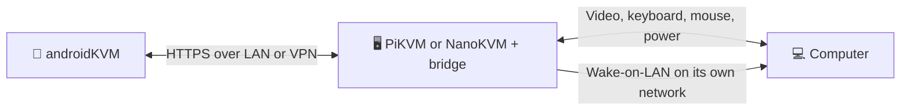

# androidKVM 🦝

A free Android app for controlling your computer through **PiKVM** or a **NanoKVM with the [PiKVM bridge](https://github.com/Sergi095/nanokvm-pikvm-bridge)**. Watch the screen, use your phone's keyboard and touch controls, manage power, and save multiple KVMs.

**[⬇️ Download the latest APK](https://github.com/Sergi095/androidKVM/releases/latest)** · Android 8.0+

## How it works

| Saved KVMs | Remote screen | Keyboard and extra keys |
| :---: | :---: | :---: |
|  |  |  |

*Screenshots use a demo KVM; your Android keyboard may look different.*

## Get started

1. **Install** the [signed release APK](https://github.com/Sergi095/androidKVM/releases/latest).
2. **Add a KVM** with its HTTPS address and web login. For NanoKVM, connect to the [bridge](https://github.com/Sergi095/nanokvm-pikvm-bridge) address. Include its port if needed, for example `nanokvm:8443`.
3. **Connect.** Save the KVM to reconnect with one tap. If Android asks you to trust its certificate, confirm only if it is the device you intended to reach.

## Controls at a glance

| To do this | Use this |
| --- | --- |
| Move and click | Touch the video. Double tap to double click; long press and move to drag. Two-finger tap to right click; swipe with two fingers to scroll. |
| Type | Tap **⌨** for your Android keyboard. The extra key bar includes Ctrl, Alt, arrows, F1–F12, and Delete. Hide the keyboard to enlarge the screen. |
| Power on or shut down | Tap **⏻** in the console. These buttons follow the KVM's reported power state. |
| Wake a sleeping PC | On its saved KVM card, open **WOL settings** and enter the **PC's wired MAC address**. Then tap **⏻ → Wake via WOL**. PiKVM also needs [WOL configured on the device](https://docs.pikvm.org/wol/). |
| Lock the app | Tap **⋮ → Security settings**. Choose a 6–12 digit PIN, biometrics, or both. Both means **either** can unlock. The lock appears whenever you reopen the app. |
| Update | Open **Updates → Check for updates → Download and install**. Install over the existing app to keep saved KVMs. |

**WOL over VPN:** The KVM sends the wake packet on its own network. Your phone only needs to reach the KVM; it does not need a VPN broadcast IP. NanoKVM WOL requires the bridge and native NanoKVM service on the same host with a shared trusted certificate.

Saved KVM passwords are encrypted on your phone. With the app lock enabled, Android hides the app's recent-screen preview. Biometric-only mode also allows your Android screen lock as a fallback.

## References

- **PiKVM:** [HTTP API](https://docs.pikvm.org/api/) · [input WebSocket source](https://github.com/pikvm/kvmd/blob/master/kvmd/apps/kvmd/api/hid.py) · [video modes](https://docs.pikvm.org/video/) · [Wake-on-LAN](https://docs.pikvm.org/wol/)
- **NanoKVM:** [H.264 Direct source](https://github.com/sipeed/NanoKVM/blob/main/web/src/pages/desktop/screen/direct.worker.ts) · [WOL API source](https://github.com/sipeed/NanoKVM/blob/main/server/router/network.go) · [PiKVM bridge](https://github.com/Sergi095/nanokvm-pikvm-bridge)
- **Android:** [Biometric Prompt guide](https://developer.android.com/identity/sign-in/biometric-auth)

## For developers

Build, release signing, and protocol notes are in [Development](docs/DEVELOPMENT.md). This project is [MIT licensed](LICENSE).
