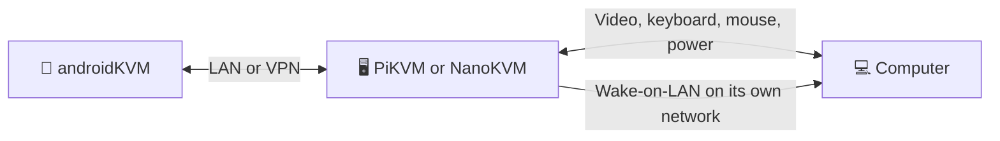

# androidKVM 🦝

A free Android app for controlling your computer through **PiKVM or NanoKVM directly**. Watch the screen, use your phone's keyboard and touch controls, manage power, and save multiple KVMs.

**[⬇️ Download the latest APK](https://github.com/Sergi095/androidKVM/releases/latest)** · Android 8.0+

## How it works

| Saved KVMs | Remote screen | Keyboard and extra keys |
| :---: | :---: | :---: |
|  |  |  |

*Screenshots use a demo KVM; your Android keyboard may look different.*

## Get started

1. **Install** the [signed release APK](https://github.com/Sergi095/androidKVM/releases/latest).
2. **Add a KVM.** Select PiKVM or NanoKVM and enter the device's own address and web login. PiKVM uses HTTPS. NanoKVM accepts HTTPS or its stock HTTP address; enter `http://` explicitly for HTTP. Include a port when needed.
3. **Connect.** Save the KVM to reconnect with one tap. If Android asks you to trust its certificate, confirm only if it is the device you intended to reach.

If you previously used the [NanoKVM PiKVM bridge](https://github.com/Sergi095/nanokvm-pikvm-bridge), add the NanoKVM's own address as a new **NanoKVM** entry. Remove the old entry after testing the direct connection.

## Controls at a glance

| To do this | Use this |
| --- | --- |
| Move and click | Touch the video. Double tap to double click; long press and move to drag. Two-finger tap to right click; swipe with two fingers to scroll. |
| Adjust video | Tap **⋮ → Video settings**. PiKVM settings stay limited to frame rate, JPEG quality, supported capture resolutions, and phone display. NanoKVM also offers H.264 or MJPEG, bitrate, and GOP. |
| Type | Tap **⌨** for your Android keyboard. The extra key bar includes Ctrl, Alt, arrows, F1–F12, and Delete. Hide the keyboard to enlarge the screen. |
| Use a NanoKVM terminal | Tap **⋮ → NanoKVM terminal** for its shell, or **Serial terminal** to choose a port and speed. The terminal opens inside the console and uses the same extra keys above your Android keyboard. |
| Configure NanoKVM | Tap **⋮ → NanoKVM settings** for its password, device, USB, Wi-Fi, DNS, and system controls. Open its full web interface there for other settings. **Security settings** manages the app's PIN and biometrics. |
| Reconnect input hardware | Tap **⋮ → Reset HID**. |
| Power on or shut down | Tap **⏻** in the console. These buttons follow the KVM's reported power state. |
| Wake a sleeping PC | On its saved KVM card, open **WOL settings** and enter the **PC's wired MAC address**. Then tap **⏻ → Wake via WOL**. PiKVM also needs [WOL configured on the device](https://docs.pikvm.org/wol/). |
| Lock the app | Tap **⋮ → Security settings**. Choose a 6–12 digit PIN, biometrics, or both. Both means **either** can unlock. The lock appears whenever you reopen the app. |
| Update | Open **Updates → Check for updates → Download and install**. Install over the existing app to keep saved KVMs. |

**WOL over VPN:** The KVM sends the wake packet on its own network. Your phone only needs to reach the KVM; it does not need a VPN broadcast IP.

NanoKVM's default HTTP connection sends login credentials without transport encryption. Enable HTTPS on the NanoKVM when using an untrusted network.

Saved KVM passwords are encrypted on your phone. With the app lock enabled, Android hides the app's recent-screen preview. Biometric-only mode also allows your Android screen lock as a fallback.

## References

- **PiKVM:** [HTTP API](https://docs.pikvm.org/api/) · [input WebSocket source](https://github.com/pikvm/kvmd/blob/master/kvmd/apps/kvmd/api/hid.py) · [video modes](https://docs.pikvm.org/video/) · [Wake-on-LAN](https://docs.pikvm.org/wol/)
- **NanoKVM:** [server source](https://github.com/sipeed/NanoKVM) · [HID WebSocket](https://github.com/sipeed/NanoKVM/blob/main/server/service/ws/client.go) · [H.264 Direct source](https://github.com/sipeed/NanoKVM/blob/main/web/src/pages/desktop/screen/direct.worker.ts) · [WOL API source](https://github.com/sipeed/NanoKVM/blob/main/server/router/network.go)
- **Android:** [Biometric Prompt guide](https://developer.android.com/identity/sign-in/biometric-auth)

## For developers

Build, release signing, and protocol notes are in [Development](docs/DEVELOPMENT.md). This project is [MIT licensed](LICENSE).
