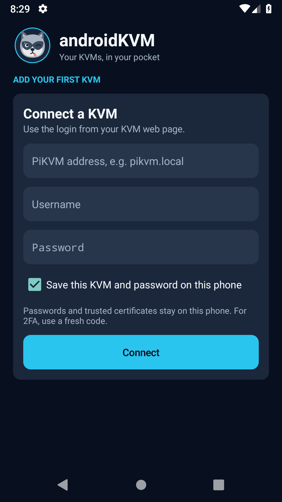
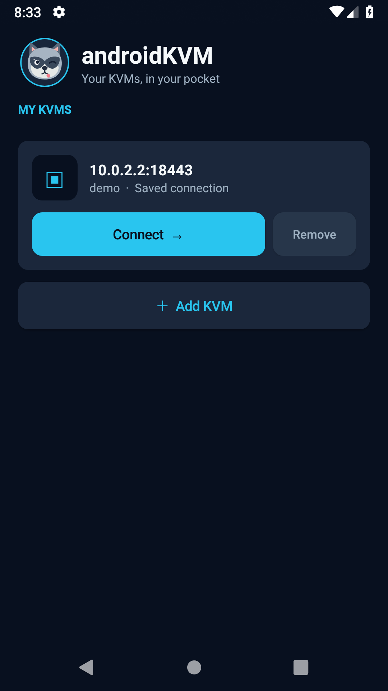
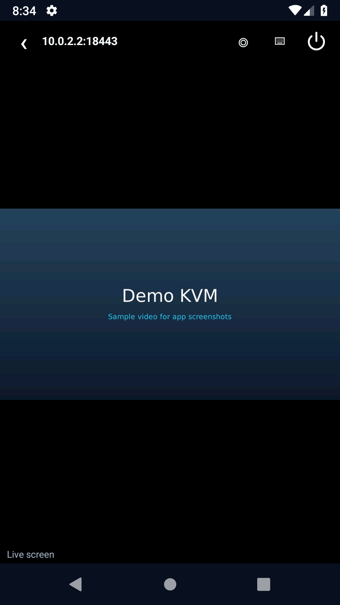
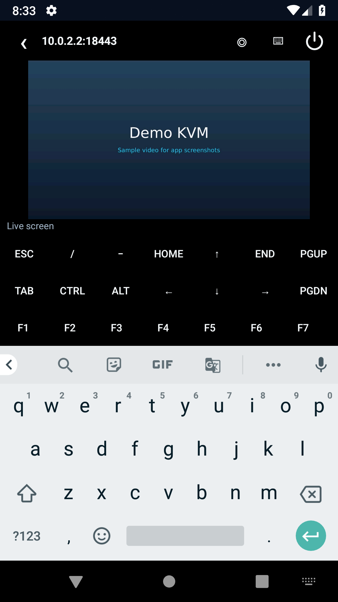
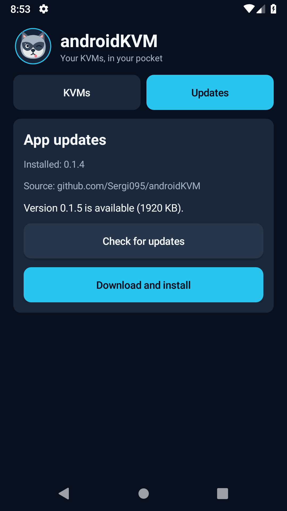
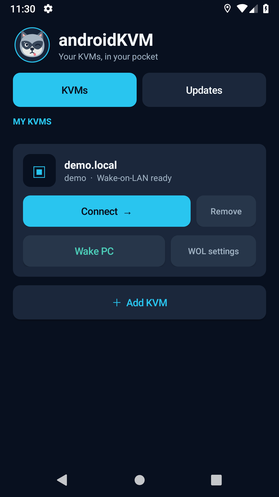
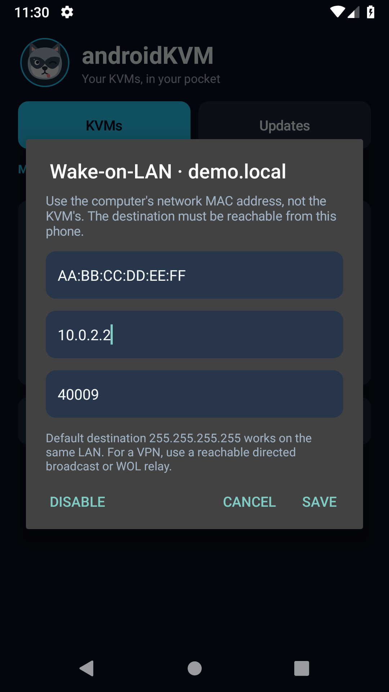

# androidKVM

androidKVM is a free, open-source Android remote console for PiKVM-compatible
devices. It shows the remote screen, sends touch or trackpad mouse input, types
through the Android keyboard with an extra key bar, and offers ATX power controls.
You can save multiple KVMs and reconnect with one tap. It connects directly to
your KVM without an app account, ads, or paid features.

PiKVM works through its own API. Sipeed NanoKVM can be used with the separate
[NanoKVM PiKVM bridge](https://github.com/Sergi095/nanokvm-pikvm-bridge), which
translates NanoKVM operations to that API. When the bridge shares a host and
certificate with NanoKVM, androidKVM can use NanoKVM's H.264 video stream.
This app contains no TouchKVM or Termux code.

## Screenshots

Captured from androidKVM in an Android emulator using a local demo KVM. The
remote video is a sample image; no personal device or credentials are shown.
Your phone's keyboard may look different.

| Add a KVM | Saved KVMs |
| --- | --- |
|  |  |

| Console | Console with keyboard |
| --- | --- |
|  |  |



| Wake button on a saved KVM | Per-KVM WOL settings |
| --- | --- |
|  |  |

## Quick start

1. Install the signed release APK from this repository's Releases page.
2. Add your KVM hostname or HTTPS address and enter its web login.
3. If prompted, trust the KVM certificate only when you expect to connect to
   that device. The app remembers the choice for saved KVMs.
4. Tap a saved KVM to reconnect. Use the keyboard button to show or hide your
   phone's keyboard and its extra keys.

## Updating an installed app

Open the **Updates** tab and tap **Check for updates**. When a newer version is
available, tap **Download and install**. The app downloads the signed APK from
[this repository's latest GitHub Release](https://github.com/Sergi095/androidKVM/releases/latest),
checks its SHA-256 digest, package name, version, and signing certificate, then
opens Android's installer. Android may ask you to allow androidKVM to install
apps the first time. Confirm **Update** in the installer. The app never installs
silently.

Install over the existing release; uninstalling first removes saved KVMs. The
package ID and release signing key stay the same, and each release raises the
version code so Android accepts the update. The debug APK has a different
signing key and cannot update a release installation.

## Features

- Log in with the KVM web account. Save several KVM profiles and tap one to
  reconnect; saved passwords are encrypted with a key in Android Keystore.
- Pick a KVM from a compact device list or add a new one. The dark console
  keeps the video prominent, with quick keyboard, mouse-mode, and power controls.
- Check for updates in the app and download verified release APKs directly from
  this repository.
- View the live screen in a console that expands when the Android keyboard is hidden.
- On a NanoKVM bridge running on the same host as NanoKVM, use its native H.264
  Direct stream with Android's video decoder when the certificate pin matches.
  Other PiKVM-compatible devices use MJPEG, and MJPEG remains the fallback.
- Move the mouse by touching or dragging on the screen. Tap for left click,
  double tap for double click, long press then move for left-button drag,
  two-finger tap for right click, and two-finger vertical swipe to scroll.
  The mouse control button can switch between direct touch and relative trackpad mode.
- See the reported ATX power LED state and send On or soft Off when ATX control is available.
- Configure Wake-on-LAN separately for each saved KVM, then tap **Wake PC** on
  its card to send a magic packet without opening the console.
- Use a Termux-style extra-key bar with Escape, Tab, Ctrl, Alt, arrows,
  Home, End, Page Up, Page Down, and a swipeable F1–F12 row. It sits directly
  above the Android keyboard and hides with it. Tap a modifier first for a shortcut.
- Type directly with the Android keyboard. The keyboard button in the console
  toolbar shows or hides it, and the remote screen adjusts to the space available.
- Mouse movement and ordinary keys use the input WebSocket for lower latency.
  Short text uses it when the KVM reports the US keymap; other text and longer
  pastes use `/api/hid/print`.

The app saves a password only when "Save this KVM and password on this phone" is
checked. Saved profiles contain the address, username, certificate trust record,
and encrypted password. The encryption key stays in Android Keystore, and Android
backup is disabled for the app. It requires HTTPS. If Android does not recognize
a KVM certificate, the app asks whether to trust that KVM before sending login
credentials. Accepting pins that exact certificate in the background. Saved KVMs
remember the choice; a changed certificate prompts again. Only trust a KVM you
expect to reach at that address.

For PiKVM with two-factor authentication, append the current one-time code to
the password during login, as specified by the PiKVM API.

## Install a local APK

Requires Android 8.0 or later. Build with JDK 17 and Android SDK platform 35:

```sh
./gradlew assembleDebug
```

The debug APK is for ADB testing and uses a different signing key. Use a signed
release APK for normal installation; Android cannot install the debug APK over
the release APK. Enter the
device hostname or HTTPS URL. The default port is 443; for a bridge listening
on another port, include it in the address, such as `nanokvm:8443`.

The phone must be able to reach the KVM over the LAN or a VPN. General PiKVM
video uses `/streamer/stream` (MJPEG). On a bridge identified through `/api/info`,
the app also tries `https://<same-host>:443/api/stream/h264/direct` after verifying
that the native service presents the same pinned certificate. Audio and virtual
media are outside this initial app.

Power buttons follow the KVM's reported ATX LED state. If the screen is live
but the app reports the power LED as off, check the KVM or bridge's ATX sensing
before relying on those buttons.

### Wake-on-LAN

On a saved KVM card, tap **Set up Wake-on-LAN**. Enter the **computer's wired
network MAC address** (not the PiKVM or NanoKVM MAC), a broadcast destination,
and a UDP port. The defaults are `255.255.255.255` and port `9` for a phone on
the same LAN. After saving, tap **Wake PC**; the app reports when it sent the
packet, but cannot confirm that the computer woke. Use **WOL settings** to edit
or disable it. These settings stay attached to the saved KVM when you reconnect.

Wake-on-LAN must be enabled in the computer's firmware and network adapter. If
the phone connects through a VPN or another subnet, use a reachable directed
broadcast address or a WOL relay; routers may block broadcast packets.

## GitHub Actions releases

The workflow builds a debug APK on pushes and manual runs. A `v*` tag also
builds a signed release APK and uploads it to a GitHub Release. Tagged releases
use these repository secrets:

| Secret | Value |
| --- | --- |
| `ANDROIDKVM_KEYSTORE_BASE64` | Base64 of the release `.jks` file, without line breaks |
| `ANDROIDKVM_STORE_PASSWORD` | Keystore password |
| `ANDROIDKVM_KEY_ALIAS` | Key alias |
| `ANDROIDKVM_KEY_PASSWORD` | Key password |

Keep the release keystore safe. Android updates require APKs signed with the
same key. Releases are published from this public GitHub repository.

## Protocol references

- [PiKVM HTTP API](https://docs.pikvm.org/api/)
- [PiKVM input WebSocket API](https://github.com/pikvm/kvmd/blob/master/kvmd/apps/kvmd/api/hid.py)
- [PiKVM video modes](https://docs.pikvm.org/video/)
- [NanoKVM Direct H.264 stream](https://github.com/sipeed/NanoKVM/blob/main/web/src/pages/desktop/screen/direct.worker.ts)
- [NanoKVM PiKVM bridge](https://github.com/Sergi095/nanokvm-pikvm-bridge)
  translates the NanoKVM API to PiKVM-compatible login, ATX, HID, and video paths.

## License

MIT. See [LICENSE](LICENSE).
The raccoon app icon is an original vector included under the same license.
